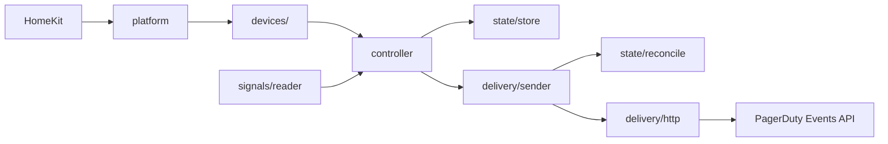

# Development

HomeKit talks to the platform. The platform owns accessory identity and starts one controller. The controller holds the saved state, turns switch writes, timers, maintenance and signal rows into desired state, and wakes one sender. The sender asks the reconciler what to send next and posts it to PagerDuty.



- `src/state/` is the model. `desired.ts` computes what should be true, `reconcile.ts` compares it with what PagerDuty accepted and picks the next action, `mutations.ts` holds every change to saved state, and `store.ts` reads and writes the state file. `reconcile.ts` and `desired.ts` are pure: no timers, no I/O.
- `src/delivery/` sends events: event bodies, the HTTPS client, the sender with its backoff, and the delivery-health tracker.
- `src/signals/` is the published signal store: the schema text and the SQLite reader.
- `src/devices/` holds the HomeKit accessories, and `src/platform.ts` connects them to the controller. `src/diagnostics/` is the opt-in health heartbeat.

PagerDuty facts live in [docs/EVENTS-API.md](docs/EVENTS-API.md), and the signal store interface in [docs/SIGNALS.md](docs/SIGNALS.md) and [docs/SIGNALS-AGENT.md](docs/SIGNALS-AGENT.md), not here.

`dist/` is committed so a git install works. CI fails if it drifts from `src/`. Run `npm run build` and commit `dist/` with every source change. Do not add a `prepare` script: it dirties the tree on every `npm install`. `prepublishOnly` rebuilds before a publish.

## Invariants

Break one of these and someone does not get paged, gets paged for nothing, or loses their tiles.

- **A trigger is never lost silently.** It is delivered, or rejected with a `warn` and an open delivery sensor, or held by maintenance with an `info` line.
- **Resolves are never held.** Maintenance holds triggers and raises only.
- **Delivered state is written only after a `2xx`.**
- **What is recorded on `2xx` is what was sent,** not the desired state at the moment the response arrives. A raise made while a request was in flight is still a gap.
- **A read error is never a clear.** That applies to the signal store and to the state file. When state has to start empty after corruption, every desired-closed key gets a `resolve`. Any other read error disables the platform.
- **An invalid config entry is held, not removed.** Only an `id` that is absent from config is a removal.
- **The routing key never reaches a log.** Not its value, its length or a prefix. The state file holds only its fingerprint. `src/utils/redact.ts` redacts by shape, so a PagerDuty error that echoes the key is still covered. Adding a log line near the key means re-reading that file first.
- **Identity is never a name.** An alert switch is its alert id plus severity, and a signal switch is its package name plus signal name. Adopt a cached accessory that matches; never replace it.
- **Bad config disables the platform. It does not unregister anything.** A usable config unregisters an alert switch when its alert `id` is removed, and a signal switch when its box is unchecked, its signal is muted, or its plugin is no longer allowed.
- **HomeKit writes never wait on PagerDuty.** A write updates state, persists, wakes the sender and returns.
- **The plugin never sends a lower severity for an open alert.**
- **The signal schema text is an interface.** `SIGNAL_SCHEMA_SQL`, `docs/SIGNALS.md`, `docs/SIGNALS-AGENT.md` and `scripts/reference-writer.js` must match character for character, and tests check all of them. The module in `docs/SIGNALS-AGENT.md` is also compiled and run against the reader. Changing the schema means raising `SIGNAL_SCHEMA_VERSION`.

## Commands

Node 22.13 or later, 24 or 26, matching `engines`. 22.13 is the first 22.x where `node:sqlite` loads without a flag, so CI runs it by exact version alongside 22, 24 and 26, plus a runtime `npm audit`.

```bash
npm install
npm run build                          # commit dist/ with the source
npm run lint                           # warnings are failures
npx tsc --noEmit -p tsconfig.test.json # src + tests
npm test                               # jest with coverage (NODE_ENV=test)
```

The suite never touches the network. Delivery tests use a stand-in transport, and the one HTTP client test talks to a loopback server. `tests/setup.js` fails the run outright if `PAGERDUTY_ROUTING_KEY` is set, so a half-finished test cannot page a real person. Test keys are built at runtime in `tests/helpers/secrets.ts`, so no key-shaped literal is committed.

Coverage is gated at 90% on statements, branches, functions and lines.

Before a release, against a PagerDuty test service:

```bash
npm run build
node scripts/smoke.js
```

Watch the service in PagerDuty while it runs. A clean exit only proves PagerDuty accepted the events.

## Test helpers

- `tests/helpers/hap.ts`: the HAP stand-in, a fake logger and a fake accessory host.
- `tests/helpers/transport.ts`: `FakeEventsApi`, a scripted PagerDuty that records every body.
- `tests/helpers/sleeps.ts`: `ManualSleeps`, so backoff is driven step by step without real waits.
- `tests/helpers/config.ts`: small builders for alerts and resolved config.

Signal reader tests use real SQLite files in a temporary directory, including a writer in a child process.

## Adding a setting

1. Add it to `PagerDutyPlatformConfig` and `ResolvedConfig` in `src/types/`, and validate it in `src/utils/validators.ts`. A bad value in one alert holds that alert; it must not disable the platform unless nothing can work without it.
2. Add it to `config.schema.json` with the same range as the validator. `tests/unit/verified-plugin.test.ts` compares them. `required` must be an array of property names (draft-07), and array items carry no `default`.
3. If it changes what is sent, it goes through `desired.ts` or `reconcile.ts`, with table-driven tests there.
4. If it should appear in diagnostics, add it to `redactConfig` in `src/diagnostics/collector.ts`. A secret appears only as present or absent.
5. Document it in the configuration reference in [docs/README-DETAILED.md](docs/README-DETAILED.md#full-configuration-reference).
6. `npm run build` and commit `dist/`.
